# B1-1. 나를 소개하는 웹페이지 처음부터 만들기

외부 라이브러리 없이 **순수 HTML · CSS · JavaScript**로 만든 반응형 포트폴리오 사이트

- 배포 URL : https://0802222.github.io/Codyssey-B1-1-MyProfile/
- 저장소 : https://github.com/0802222/Codyssey-B1-1-MyProfile

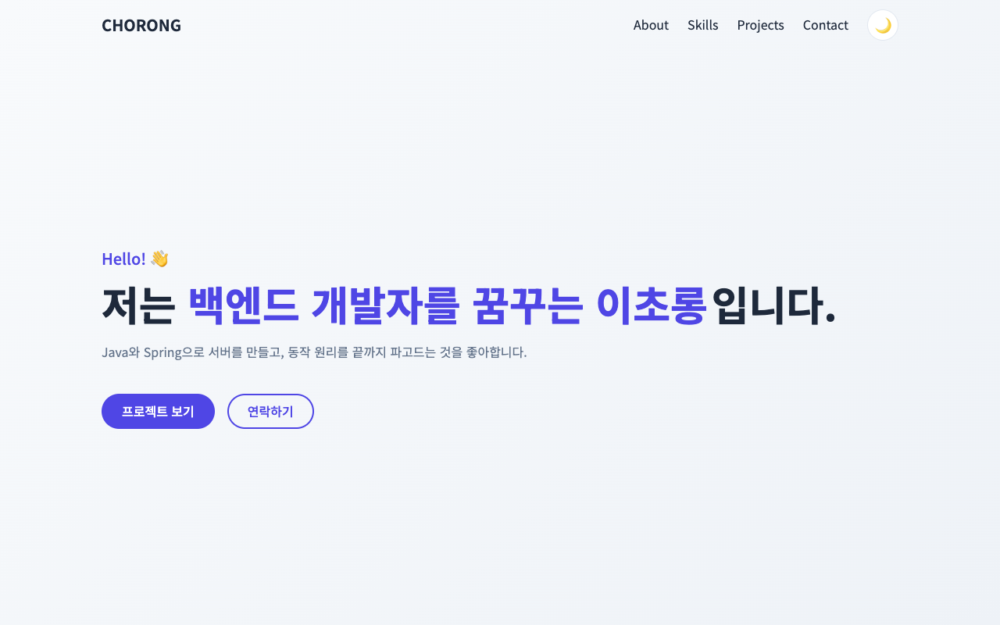

## 목차

1. [과제 소개](#1-과제-소개)
2. [배경 지식](#2-배경-지식)
3. [사용한 자료구조](#3-사용한-자료구조)
4. [사용한 알고리즘](#4-사용한-알고리즘)
5. [실행 방법](#5-실행-방법)
6. [기능](#6-기능)
7. [시연](#7-시연)
8. [프로젝트 구조](#8-프로젝트-구조)
9. [명령 처리 흐름](#9-명령-처리-흐름)
10. [예외 처리](#10-예외-처리)
11. [요구사항 체크리스트](#11-요구사항-체크리스트)
12. [테스트](#12-테스트)

### 이 문서의 예시 상황

README의 모든 그림과 예시는 아래 **한 가지 상황**을 단계별로 나눠 설명한다.

> 방문자가 **모바일(375px)** 로 사이트에 들어와 → 햄버거 메뉴로 Projects로 이동하고 → **다크 모드**를 켜고 → **Java 필터**를 누른 뒤 → 문의 폼에 이메일을 **`test@`** 로 잘못 입력했다가 고쳐서 보낸다

---

## 1. 과제 소개

- 목표 : "사용자 이벤트 → 상태 변경 → 화면 변화"가 이어지는 웹의 동작 원리를 직접 만들어 확인하기
- 다음 과제(React)의 기초 : React의 컴포넌트 · 상태 · 이벤트는 이 과제의 DOM 조작과 이벤트 처리를 추상화한 것

### 최종 결과물

| 결과물 | 내용 |
| --- | --- |
| 반응형 웹사이트 | 모바일 · 태블릿 · 데스크톱 레이아웃, Hero / About / Skills / Projects / Contact / Footer |
| 인터랙티브 UI | 다크 모드, 햄버거 메뉴, 부드러운 스크롤, 스크롤 애니메이션, 폼 유효성 검사 |
| 외부 API 연동 | GitHub API로 내 저장소 목록을 카드로 렌더링, 로딩 / 에러 / 빈 상태 표시 |
| 상태 유지 | 다크 모드 설정을 로컬스토리지에 저장 → 새로고침 후에도 유지 |
| 배포 | GitHub Pages |

### 사용 기술

| 구분 | 기술 |
| --- | --- |
| 마크업 | HTML5 (시맨틱 태그) |
| 스타일 | CSS3 (CSS 변수, Flexbox, Grid, 미디어 쿼리, transition, keyframes) |
| 스크립트 | JavaScript ES6+ (DOM API, fetch, async/await, Intersection Observer, localStorage) |
| 외부 API | GitHub REST API `GET /users/{아이디}/repos` |
| 폰트 | Google Fonts (Noto Sans KR) |
| 개발 · 배포 | VS Code + Live Server, Git, GitHub Pages |

### 과제 목표 (설명할 수 있어야 하는 것)

| 과제 목표 | README 위치 |
| --- | --- |
| 시맨틱 태그를 쓰는 이유와 내 구조 설계 기준 | [2-2. 시맨틱 태그](#2-2-시맨틱-태그) |
| Flexbox와 Grid의 차이, 언제 무엇을 고르는지 | [2-3. Flexbox와 Grid](#2-3-flexbox와-grid) |
| `querySelector`로 선택하고 `addEventListener`로 연결하는 흐름 | [2-6. DOM과 이벤트](#2-6-dom과-이벤트), [3-1. DOM 트리](#3-1-dom-트리) |
| 화살표 함수, 구조분해 할당, `map` / `filter`의 필요성과 사용법 | [2-7. ES6+ 문법](#2-7-es6-문법), [4-3. 배열 파이프라인](#4-3-배열-파이프라인-filter--map--join) |
| `fetch` + `async/await`, 로딩 / 성공 / 실패 상태를 UI로 표현한 방법 | [2-8. 비동기 처리](#2-8-비동기-처리), [4-2. 요청 상태 전이](#4-2-요청-상태-전이) |
| 이벤트 → 상태 변경 → DOM 업데이트 연결 (React 상태-렌더링의 기초) | [2-10. 상태 → 렌더링 패턴](#2-10-상태--렌더링-패턴), [9. 명령 처리 흐름](#9-명령-처리-흐름) |

### 코드 작성 규칙과 이유

과제는 기능 외에 코드를 **어떻게** 쓸지도 정해 두었다. 각 규칙이 막으려는 문제는 다음과 같다.

| 과제 규칙 | 이유 | 지킨 방법 |
| --- | --- | --- |
| 외부 라이브러리 없이 HTML · CSS · JS만 사용 | 라이브러리가 감춰 주는 DOM 조작 · 이벤트 처리를 직접 겪어 봐야 React가 무엇을 대신해 주는지 이해할 수 있다 | `<script>`는 전부 `js/` 안의 파일 (외부 주소 0개) |
| `onclick="..."` 속성 대신 `addEventListener` | HTML(구조)에 JS(동작)가 섞이지 않는다. `onclick`은 함수를 하나만 담아 다시 넣으면 덮어쓰지만, `addEventListener`는 여러 개를 등록할 수 있다. `{ passive: true }` 같은 옵션과 `removeEventListener`로 해제도 가능하다 | 모든 이벤트를 JS 파일에서 등록 ([2-6. DOM과 이벤트](#2-6-dom과-이벤트)) |
| `var` 대신 `const` · `let` | `var`는 함수 단위로만 범위가 나뉘고 같은 이름을 다시 선언해도 에러가 나지 않아 실수를 숨긴다. `const`는 재할당까지 막는다 | 기본은 `const`, 값이 바뀌는 곳만 `let` (`currentTheme`, `typedLength`) |
| 인라인 스타일(`style="..."`) 미사용 | 스타일이 HTML 곳곳에 흩어지면 한 곳에서 관리할 수 없고, CSS 변수 · 미디어 쿼리 · 다크 모드가 적용되지 않는다 | 모양은 CSS 클래스로만, JS는 `classList`로 클래스만 바꿈 |
| `<script>`에 `defer` | `<head>`의 스크립트가 아직 만들어지지 않은 요소를 찾는 문제를 막는다 | 5개 파일 모두 `defer` ([2-1](#2-1-웹-페이지를-이루는-세-언어)) |

---

## 2. 배경 지식

### 개념 찾아보기

| 묶음 | 개념 | 위치 |
| --- | --- | --- |
| HTML · 접근성 | `defer`, 시맨틱 태그, Hero 섹션, 스크린 리더 | [2-1](#2-1-웹-페이지를-이루는-세-언어), [2-2](#2-2-시맨틱-태그) |
| CSS 레이아웃 | Flexbox · Grid, 미디어 쿼리 · 모바일 퍼스트, CSS 변수 | [2-3](#2-3-flexbox와-grid), [2-4](#2-4-반응형-디자인), [2-5](#2-5-css-변수와-다크-모드) |
| JS DOM · 이벤트 | DOM, `querySelector`, `addEventListener`, 콜백, `preventDefault()`, 이벤트 위임 | [2-6](#2-6-dom과-이벤트), [4-8](#4-8-이벤트-위임) |
| JS 문법 | `const` · `let`, 화살표 함수, 템플릿 리터럴, 구조분해 할당, `map` · `filter` · `forEach` | [2-7](#2-7-es6-문법), [4-3](#4-3-배열-파이프라인-filter--map--join) |
| 비동기 | `fetch`, Promise, `async` · `await`, `try` · `catch` | [2-8](#2-8-비동기-처리) |
| 화면 갱신 | Intersection Observer, 상태 → 렌더링 | [2-9](#2-9-intersection-observer), [2-10](#2-10-상태--렌더링-패턴) |

### 2-1. 웹 페이지를 이루는 세 언어

| 개념 | 정의 | 요약 |
| --- | --- | --- |
| HTML | 문서의 구조와 내용을 태그로 표시하는 언어 | 뼈대 |
| CSS | HTML 요소의 모양과 배치를 정하는 언어 | 옷 |
| JavaScript | 브라우저에서 실행되어 화면을 바꾸는 프로그래밍 언어 | 움직임 |

- 과제 요구 : 외부 라이브러리 없이 세 언어만 사용하고, 파일을 역할별 폴더로 분리
- 구현 : `index.html`이 `css/style.css`와 `js/*.js` 5개 파일을 연결
- 세부 설명
  - 브라우저가 이해하는 언어는 이 세 가지뿐 (React도 빌드하면 결국 HTML · CSS · JS가 된다)
  - 스크립트는 `<head>`에 `defer`로 연결해서, HTML을 다 읽은 뒤 순서대로 실행된다

    ```html
    <script src="js/theme.js" defer></script>
    ```

  - `defer` 유무에 따른 차이

    | 구분 | 일반 `<script>` | `<script defer>` |
    | --- | --- | --- |
    | 다운로드 | HTML 파싱을 멈추고 받음 | HTML 파싱과 병렬로 받음 |
    | 실행 시점 | 받자마자 바로 실행 | HTML 파싱이 끝난 뒤 (`DOMContentLoaded` 직전) |
    | 실행 순서 | 적힌 순서 | 적힌 순서 보장 |
    | `<head>`에서 `querySelector` | 아직 요소가 없어 `null` | 요소가 모두 만들어진 뒤라 항상 찾음 |

### 2-2. 시맨틱 태그

- 정의 : 이름만 보고도 역할을 알 수 있는 HTML 태그 (`<header>`, `<nav>`, `<main>`, `<section>`, `<article>`, `<footer>`)
- 요약 : `<div>`는 "상자", 시맨틱 태그는 "이름표가 붙은 상자"
- 과제 요구 : 전체를 `div`로만 감싸지 않고 시맨틱 태그로 구조 작성
- 구현 : `index.html`
- 세부 설명
  - 왜 쓰는가
    - 스크린 리더가 "탐색 메뉴", "본문"처럼 영역을 구분해 읽어 준다
    - 검색 엔진이 본문(`<main>`)과 부가 정보를 구분한다
    - 코드를 읽는 사람이 구조를 바로 파악한다
  - 내가 정한 구조 기준

    | 태그 | 기준 | 사용한 곳 |
    | --- | --- | --- |
    | `<header>` | 모든 화면에 공통으로 붙는 상단 영역 | 로고 + 메뉴 |
    | `<nav>` | 다른 위치로 이동하는 링크 묶음 | 섹션 앵커 메뉴 |
    | `<main>` | 페이지의 핵심 내용, 한 번만 | Hero ~ Contact |
    | `<section>` | 제목(`h2`)을 가진 주제 단위 | About, Skills, Projects, Contact |
    | `<article>` | 떼어 내도 혼자 의미가 통하는 내용 | 스킬 카드, 프로젝트 카드 |
    | `<footer>` | 저작권 · 연락처 같은 마무리 정보 | 저작권, GitHub 링크 |

  - Hero 섹션
    - 정의 : 페이지에 들어오자마자 처음 보이는 가장 큰 첫 화면 영역 (웹 디자인 용어, 데이터를 저장하는 곳이 아니다)
    - 용도 : 방문자가 몇 초 안에 "누구의, 무슨 페이지인지" 알고 다음 행동을 고르게 한다
    - 주로 넣는 것

      | 요소 | 역할 | 이 페이지 |
      | --- | --- | --- |
      | 큰 제목 (`h1`) | 페이지의 핵심 한 문장 | "저는 백엔드 개발자를 꿈꾸는 이초롱입니다." |
      | 짧은 소개 | 제목을 보충하는 한두 줄 | Java · Spring 관심사 |
      | CTA (Call To Action, 행동 유도) 버튼 | 다음에 갈 곳 안내 | 프로젝트 보기, 연락하기 |
      | 시각 요소 | 첫인상 (배경 이미지, 일러스트, 애니메이션) | 타이핑 효과 |

    - 구현 : `index.html`의 `<section id="hero">`, 타이핑 효과는 `js/animation.js`

  - 접근성
    - 모든 이미지에 의미 있는 `alt` (예: `alt="이초롱의 프로필 이미지 (이니셜 CR 아바타)"`)
    - 폼은 `<label for="email">` ↔ `<input id="email">`로 연결 → 라벨을 눌러도 입력칸에 포커스
    - 스크린 리더 (Screen Reader) : 화면 내용을 음성으로 읽어 주는 **운영체제(OS)의 접근성 기능**이다. 브라우저 기능이 아니며, OS에서 켜 두면 브라우저 페이지도 읽어 준다

      | 기기 | 이름 | 켜는 법 |
      | --- | --- | --- |
      | iPhone | VoiceOver | 설정 → 손쉬운 사용 → VoiceOver |
      | Android | TalkBack | 설정 → 접근성 → TalkBack |
      | Mac | VoiceOver | `Cmd + F5` |
      | Windows | 내레이터 (Narrator) | `Win + Ctrl + Enter` |

    - 스크린 리더는 화면 모양이 아니라 HTML 구조와 `aria-*` 속성을 읽기 때문에, 아래 속성으로 읽을 내용을 보충했다

      <details>
      <summary>스크린 리더를 위해 사용한 속성과 위치</summary>

      | 코드 | 위치 | 역할 |
      | --- | --- | --- |
      | `lang="ko"` | `index.html` `<html>` | 한국어 발음으로 읽음 |
      | `alt` | `index.html` 프로필 이미지 | 이미지 내용을 읽어 줌 |
      | `aria-label` | `index.html` 테마 · 햄버거 · 맨 위로 버튼 | 아이콘만 있는 버튼의 이름 |
      | `aria-expanded` | `index.html` 햄버거 버튼, `js/nav.js` `updateToggleLabel()` | 메뉴 열림 / 닫힘 상태 |
      | `aria-live="polite"` | `index.html` `.projects__content` | 프로젝트 목록이 바뀌면 읽어 줌 |
      | `role="status"` | `index.html` `.contact-form__success` | 폼 제출 성공 메시지를 읽어 줌 |
      | `aria-describedby` | `index.html` 폼 입력칸 | 입력칸과 에러 문구를 연결 |
      | `aria-invalid` | `js/form.js` `renderFieldError()` | 잘못 입력한 칸임을 알림 |
      | `aria-pressed` | `js/projects.js` `createFilterButtons()` | 필터 버튼 선택 여부 |
      | `aria-hidden="true"` | `js/projects.js` 로딩 스피너 | 장식용 요소는 읽지 않음 |

      </details>

### 2-3. Flexbox와 Grid

| 개념 | 정의 | 요약 |
| --- | --- | --- |
| Flexbox | 요소를 **한 방향(가로 또는 세로)** 으로 늘어놓고 정렬하는 레이아웃 | 1차원, 한 줄 정렬 |
| Grid | 요소를 **행과 열**로 이루어진 격자에 배치하는 레이아웃 | 2차원, 바둑판 |

- 과제 요구 : 네비게이션은 Flexbox(로고 왼쪽, 메뉴 오른쪽), Projects 카드는 Grid(`auto-fit`, `minmax`)
- 구현 : `css/style.css`의 `.nav`, `.projects__grid`
- 세부 설명
  - 선택 기준 : "한 줄로 늘어놓고 정렬"이면 Flexbox, "행과 열을 같이 맞춤"이면 Grid

    | 사용한 곳 | 선택 | 이유 |
    | --- | --- | --- |
    | `.nav` | Flexbox | 로고 · 메뉴 · 버튼을 한 줄에 놓고 양 끝으로 벌림 |
    | `.skill-card__list` | Flexbox | 태그를 한 줄로 놓다가 넘치면 줄바꿈(`flex-wrap`) |
    | `.projects__grid` | Grid | 카드 높이와 너비를 행 · 열 단위로 맞춤 |
    | `.skills` | Grid | 화면 크기별 1열 → 2열 → 3열 |

  - `auto-fit` + `minmax` : 미디어 쿼리 없이 화면 폭에 맞춰 열 개수가 바뀐다

    ```css
    .projects__grid {
      grid-template-columns: repeat(auto-fit, minmax(260px, 1fr));
    }
    ```

    - 카드 하나의 최소 폭은 260px, 남는 공간은 `1fr`로 나눠 가짐
    - 결과 : 375px → 1열, 800px → 2열, 1280px → 3열 ([테스트](#12-테스트)에서 확인)

### 2-4. 반응형 디자인

| 개념 | 정의 | 요약 |
| --- | --- | --- |
| 미디어 쿼리 | 화면 폭 같은 조건에 따라 다른 CSS를 적용하는 문법 (`@media`) | 조건부 CSS |
| 모바일 퍼스트 | 모바일 스타일을 기본으로 쓰고, 넓은 화면용 스타일을 `min-width`로 덧붙이는 방식 | 작은 화면부터 |

- 과제 요구 : 모바일 퍼스트, 브레이크포인트 768px(태블릿) · 1024px(데스크톱), 모바일에서 메뉴 숨김 + 햄버거 버튼
- 구현 : `css/style.css` 12번(768px), 13번(1024px) 구역
- 세부 설명
  - 기본 CSS = 모바일 : 메뉴 `display: none`, 햄버거 버튼 보임, 카드 1열
  - `@media (min-width: 768px)` : 햄버거 숨김, 메뉴를 가로로 표시, About을 가로 배치, Skills 2열
  - `@media (min-width: 1024px)` : 큰 제목 글자, 넓은 여백, Skills 3열
  - 모바일 퍼스트를 고른 이유 : 작은 화면의 단순한 레이아웃에서 기능을 "추가"하는 쪽이 "덜어 내는" 쪽보다 CSS가 짧다

### 2-5. CSS 변수와 다크 모드

| 개념 | 정의 | 요약 |
| --- | --- | --- |
| CSS 변수 | `--이름: 값`으로 선언하고 `var(--이름)`으로 꺼내 쓰는 값 | 색 · 폰트 · 간격의 이름표 |
| `[data-theme="dark"]` | `<html data-theme="dark">`일 때만 적용되는 속성 선택자 | 다크 모드용 값 덮어쓰기 |

- 과제 요구 : `:root`에 색상 · 폰트 · 간격 정의, 다크 모드 변수는 `[data-theme="dark"]`에 별도 정의
- 구현 : `css/style.css` 1번 구역
- 세부 설명
  - 컴포넌트는 색을 직접 쓰지 않고 변수만 쓴다

    ```css
    :root               { --color-bg: #f8fafc; }
    [data-theme="dark"] { --color-bg: #0f172a; }
    body                { background-color: var(--color-bg); }
    ```

  - 그래서 JS는 `<html>`의 `data-theme` 속성 **하나만** 바꾸면 페이지 전체 색이 바뀐다

### 2-6. DOM과 이벤트

| 개념 | 정의 | 요약 |
| --- | --- | --- |
| DOM | 브라우저가 HTML을 읽어 만든 **요소 객체의 트리** | JS가 만지는 HTML |
| `querySelector` / `querySelectorAll` | CSS 선택자로 요소를 1개 / 전부 찾는 메서드 | 요소 찾기 |
| `addEventListener` | 요소에 "이 일이 생기면 이 함수를 실행"을 등록하는 메서드 | 이벤트 연결 |
| `event.preventDefault()` | 브라우저의 기본 동작(링크 이동, 폼 제출 새로고침)을 막는 메서드 | 기본 동작 취소 |
| `classList` | 요소의 class를 `add` / `remove` / `toggle`하는 객체 | 스타일 스위치 |

- 과제 요구 : `onclick` 속성 대신 `addEventListener`, `click` · `submit` · `scroll` · `input` 이벤트 처리
- 구현 : `js/` 전체 (사용 위치는 아래 표)
- 세부 설명
  - DOM (Document Object Model, 문서 객체 모델)이 필요한 이유
    - HTML 파일은 그냥 **문자열**이다. 문자열에는 "세 번째 버튼에 class를 붙여라" 같은 명령을 내릴 수 없다
    - 브라우저는 HTML을 해석해 태그 하나하나를 **객체**(속성 + 메서드를 가진 값)로 만든다. JS는 이 객체를 다룬다
    - 브라우저는 원본 HTML 문자열이 아니라 **DOM을 보고 화면을 그린다**. 그래서 DOM을 바꾸면 화면이 바뀌고, 문자열을 바꾸면 아무 일도 일어나지 않는다
  - 트리(Tree) 모양인 이유
    - HTML은 태그 안에 태그가 들어가는 **중첩 구조**다 (`<body>` 안에 `<main>`, 그 안에 `<section>`)
    - 모든 요소의 부모는 하나, 자식은 여러 개 → 그대로 옮기면 나무를 거꾸로 세운 모양이 된다
  - 트리 구조 덕분에 되는 것

    | 기능 | 설명 | 이 프로젝트 |
    | --- | --- | --- |
    | 선택자로 찾기 | 트리를 훑어 조건에 맞는 노드를 찾는다 | `querySelector('.nav__menu')` |
    | 위치로 찾기 | 부모 · 자식 · 형제 방향으로 이동한다 | `event.target.closest('.filter-btn')` (부모 방향) |
    | 내용 · 모양 바꾸기 | 노드 객체의 값을 바꾸면 화면이 바뀐다 | `textContent`, `innerHTML`, `classList` |
    | 이벤트 버블링 | 자식에서 일어난 이벤트가 부모로 전달된다 | [4-8. 이벤트 위임](#4-8-이벤트-위임) |
    | 상속 | 부모의 글꼴 · 색 · CSS 변수가 자식에게 이어진다 | `<html data-theme>` 하나로 전체 색 변경 |
    | 통째로 교체 | 부모 안을 갈아 끼우면 자식도 모두 바뀐다 | `projectsContent.innerHTML = ...` |

  - 흐름 : **찾기**(`querySelector`) → **연결**(`addEventListener`) → **바꾸기**(`classList`, `textContent`, `innerHTML`)

    ```js
    const navToggle = document.querySelector('.nav__toggle'); // 1. 찾기
    navToggle.addEventListener('click', () => {               // 2. 연결
      navMenu.classList.toggle('active');                     // 3. 바꾸기
    });
    ```

  - 이벤트별 사용 위치

    | 이벤트 | 파일 · 대상 | 하는 일 |
    | --- | --- | --- |
    | `click` | `nav.js` 햄버거 · 앵커 · 맨 위로 버튼, `theme.js` 토글, `projects.js` 필터 · 재시도 | 메뉴, 이동, 테마, 필터 |
    | `submit` | `form.js` 문의 폼 | 전체 검증 후 성공 메시지 |
    | `scroll` | `nav.js` window | 헤더 배경, 맨 위로 버튼 |
    | `input` | `form.js` 문의 폼 | 입력할 때마다 해당 필드 검증 |

  - `onclick="..."`을 쓰지 않는 이유 : [코드 작성 규칙과 이유](#코드-작성-규칙과-이유) 참고
  - 이벤트 처리와 콜백
    - `addEventListener('click', 함수)`의 두 번째 인자가 **콜백**이다. 등록할 때는 실행되지 않고, 이벤트가 일어날 때 브라우저가 `event` 객체를 넣어 대신 호출한다
    - 그래서 함수 이름 뒤에 `()`를 붙이지 않는다. `addEventListener('scroll', handleScroll())`라고 쓰면 등록하는 순간 한 번 실행되고, 그 반환값(`undefined`)이 등록된다

      ```js
      window.addEventListener('scroll', handleScroll, { passive: true }); // nav.js : 함수 자체를 넘김
      ```

  - `event.preventDefault()` : 내가 설계한 동작을 하기 위해 브라우저의 기본 동작을 취소한다

    | 위치 | 취소한 기본 동작 | 대신 하는 일 |
    | --- | --- | --- |
    | `form.js` submit | 페이지 새로고침 + 서버로 전송 (입력값과 에러 메시지가 사라짐) | JS로 검증하고 성공 메시지 표시 |
    | `nav.js` 앵커 click | `#about` 위치로 순간 이동 | `scrollIntoView({ behavior: 'smooth' })`로 부드럽게 이동 |

    - `stopPropagation()`과는 다르다. 그쪽은 이벤트가 부모로 전달되는 것(버블링)을 막는다
  - `textContent` vs `innerHTML`
    - `textContent` : 글자만 바꿈 (에러 메시지, 테마 아이콘)
    - `innerHTML` : HTML 문자열을 해석해 요소를 만듦 (프로젝트 카드) → 외부 문자열은 `escapeHTML`로 먼저 처리

### 2-7. ES6+ 문법

| 개념 | 정의 | 요약 |
| --- | --- | --- |
| `const` / `let` | 블록 단위로 유효한 변수 선언 (`const`는 재할당 불가) | `var` 대체 |
| 화살표 함수 | `(인자) => 결과` 형태의 짧은 함수 | 짧은 콜백 |
| 콜백 함수 | 다른 함수에 인자로 넘겨서, 그 함수가 나중에 대신 호출하는 함수 | "끝나면 이거 불러 줘" |
| 템플릿 리터럴 | 백틱(`` ` ``) 안에 `${값}`을 끼워 넣는 문자열 | HTML 조립 |
| 구조분해 할당 | 객체 · 배열에서 필요한 값만 꺼내 변수로 만드는 문법 | 값 골라 꺼내기 |
| `map` / `filter` / `forEach` | 배열을 변환 / 거르기 / 순회하는 메서드 | 반복문 대신 |

- 과제 요구 : 화살표 함수, 템플릿 리터럴로 HTML 생성, 구조분해 할당, `map`(카드 변환) · `filter`(조건) · `forEach`(순회)
- 구현 : `js/projects.js` 중심
- 세부 설명
  - 왜 필요한가 : "어떻게 반복할지"(for문 인덱스) 대신 "무엇을 할지"만 적어서 코드가 짧고 실수가 줄어든다
  - 사용 예시 (모두 `js/projects.js`)

    ```js
    // 구조분해 + 화살표 함수 : API 응답에서 필요한 값만 꺼내 새 객체로
    const toProject = ({ name, description, html_url, language, stargazers_count, updated_at }) => ({ ... });

    // filter + map : 포크 저장소를 빼고 카드용 객체로 변환
    const repos = data.filter(({ fork }) => !fork).map(toProject);

    // 템플릿 리터럴 : 카드 HTML 조립
    const createProjectCard = ({ name, stars }) => `<h3>${escapeHTML(name)}</h3><span>⭐ ${stars}</span>`;
    ```

  - 콜백을 넘긴 곳

    | 위치 | 콜백을 받는 쪽 | 호출되는 때 |
    | --- | --- | --- |
    | 모든 JS 파일 | `addEventListener` | 이벤트가 일어날 때 |
    | `animation.js` | `IntersectionObserver` | 요소가 화면에 들어올 때 |
    | `animation.js` | `setTimeout(typeNextChar, 90)` | 90ms 뒤 |
    | `projects.js` | `map(toProject)`, `filter(...)` | 배열 요소마다 |

  - 구조분해 할당 (Destructuring Assignment)
    - 이름의 뜻 : `{ name, fork }`처럼 값을 묶어 **구조를 만드는 것**의 반대로, 묶인 구조를 **해체**(de-structure)해 변수로 나눠 담는다
    - 만드는 문법과 꺼내는 문법이 거울처럼 같다

      ```js
      const repo = { name, fork };  // 구조 만들기
      const { name, fork } = repo;  // 구조 해체하기
      ```

    - 사용한 곳

      | 위치 | 코드 | 꺼낸 값 |
      | --- | --- | --- |
      | `projects.js` `toProject()` | `({ name, description, html_url, ... }) =>` | API 응답의 수십 개 필드 중 화면에 쓰는 6개 |
      | `projects.js` `renderProjects()` | `const { status, repos, ... } = projectsState;` | 상태 객체의 값 |
      | `projects.js` `fetchRepos()` | `data.filter(({ fork }) => !fork)` | 포크 여부 |
      | `nav.js` `handleScroll()` | `const { scrollY } = window;` | 현재 스크롤 위치 |
      | `animation.js` | `({ isIntersecting, target }) =>` | 화면에 들어왔는지, 대상 요소 |
      | `form.js` submit | `const { name } = Object.fromEntries(...)` | 폼의 이름 값 |

  - `forEach` : `nav.js`에서 모든 앵커 링크에 클릭 이벤트 등록, `animation.js`에서 등장 대상 관찰 등록
  - `var` 미사용 : 프로젝트 전체 `grep "var "` 결과 0건

### 2-8. 비동기 처리

| 개념 | 정의 | 요약 |
| --- | --- | --- |
| `fetch` | 네트워크 요청을 보내고 **Promise**(나중에 도착할 결과)를 돌려주는 함수 | HTTP 요청 |
| `async` / `await` | Promise 결과가 올 때까지 함수 안에서만 기다리게 하는 문법 | 비동기를 순서대로 읽히게 |
| `try` / `catch` | 실행 중 에러가 나면 `catch` 블록으로 넘어가 처리하는 문법 | 에러 잡기 |

- 과제 요구 : `fetch` + `async/await`로 `https://api.github.com/users/{아이디}/repos` 호출, `try/catch`로 에러 처리, 로딩 · 성공 · 에러 · 빈 상태 UI
- 구현 : `js/projects.js`의 `fetchRepos()`
- 세부 설명
  - 요청 주소 : `https://api.github.com/users/0802222/repos?sort=updated&per_page=100`
    - `sort=updated` : 최근 수정 순
    - `per_page=100` : 기본값 30개를 넘는 저장소(43개)를 한 번에 받기
  - `await` 중에도 페이지는 멈추지 않는다 (스크롤, 다크 모드 모두 동작)
  - `fetch`는 404 · 403 응답에서도 **에러를 던지지 않는다** → `response.ok`를 직접 확인해서 `throw`

    ```js
    const response = await fetch(GITHUB_REPOS_URL);
    if (!response.ok) {
      throw new Error(getErrorMessage(response.status));
    }
    ```

  - 상태 UI는 [4-2. 요청 상태 전이](#4-2-요청-상태-전이)에서 설명

### 2-9. Intersection Observer

- 정의 : 요소가 화면(뷰포트)에 **얼마나 보이는지**를 브라우저가 대신 감시하다가 기준을 넘으면 콜백을 실행하는 API
- 요약 : "이 요소가 20% 보이면 알려 줘"
- 과제 요구 : 스크롤 애니메이션, 임계값(threshold) 0.2 이상 권장 + README에 명시
- 구현 : `js/animation.js`의 `revealObserver`
- 세부 설명
  - **사용한 임계값 : `0.2`** (요소의 20%가 보이면 등장)
  - `scroll` 이벤트로 직접 계산하면 스크롤할 때마다 위치를 계산해야 하지만, Observer는 브라우저가 필요할 때만 알려 준다
  - 동작은 [4-7. 등장 애니메이션](#4-7-등장-애니메이션)에서 설명

### 2-10. 상태 → 렌더링 패턴

- 정의 : 화면에 보여 줄 데이터(**상태**)를 변수 한곳에 두고, 화면은 항상 **그 상태를 보고 다시 그리는** 방식
- 요약 : 이벤트는 상태만 바꾸고, 그리는 건 `render` 함수 하나가 맡는다
- 과제 요구 : "사용자 이벤트 → 상태 변경 → 화면 업데이트" 흐름 3개 이상
- 구현 : 4개 흐름

  | 흐름 | 상태 | 렌더링 함수 |
  | --- | --- | --- |
  | 다크 모드 토글 | `currentTheme` (`theme.js`) | `renderTheme()` |
  | API 호출 | `projectsState.status` (`projects.js`) | `renderProjects()` |
  | 폼 입력 | `formErrors` (`form.js`) | `renderFieldError()` |
  | [보너스] 필터 클릭 | `projectsState.selectedLanguage` (`projects.js`) | `renderProjects()` |

- 세부 설명
  - 좋은 점 : 화면이 어떻게 보일지는 "상태"만 보면 알 수 있다 (여기저기서 DOM을 직접 고치지 않음)
  - React와의 연결 : `setProjectsState(...)` → `renderProjects()`는 React의 `setState` → 다시 렌더링과 같은 구조

---

## 3. 사용한 자료구조

### 3-1. DOM 트리

- 정의 : HTML 태그를 부모-자식 관계의 **노드 트리**로 만든 객체 구조
- 요약 : JS가 화면을 찾고 바꾸는 지도
- 과제 요구 : `querySelector` / `querySelectorAll`로 요소 선택
- 구현 : 각 파일 맨 위에서 필요한 요소를 한 번만 찾아 `const`에 저장 (예: `nav.js`의 `navMenu`, `navToggle`)
- 세부 설명
  - `querySelector('.nav__menu')` : 트리를 위에서부터 훑어 처음 맞는 노드 1개
  - `querySelectorAll('a[href^="#"]')` : 맞는 노드 전부 (NodeList → `forEach` 가능)
  - 이벤트는 클릭한 노드에서 부모 쪽으로 **거슬러 올라간다**(버블링) → [4-8. 이벤트 위임](#4-8-이벤트-위임)에서 활용

**예시 상황** : 모바일 방문자가 햄버거 버튼을 누르면, JS는 트리에서 `nav__toggle`과 `nav__menu`를 찾아 둘 다 `active` 클래스를 붙인다

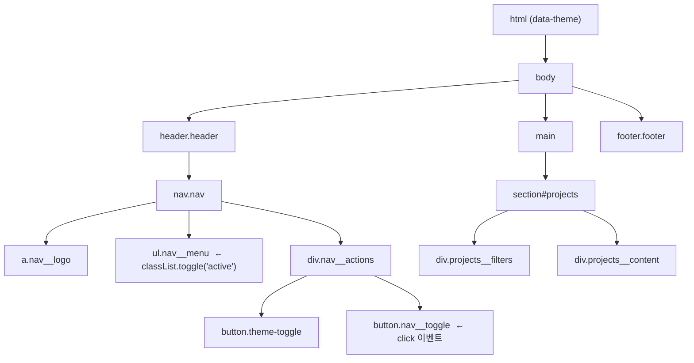

### 3-2. 상태 객체

- 정의 : 화면을 그리는 데 필요한 값을 한 객체에 모아 둔 것
- 요약 : 화면의 "원본 데이터"
- 과제 요구 : 상태 → 렌더링 흐름
- 구현 : `js/projects.js`의 `projectsState`, `setProjectsState()`
- 세부 설명
  - 구조

    ```js
    const projectsState = {
      status: 'loading',        // 'loading' | 'success' | 'empty' | 'error'
      repos: [],                // 화면용으로 가공한 저장소 배열
      selectedLanguage: '전체', // [보너스] 언어 필터
      errorMessage: '',         // 에러 상태에서 보여 줄 문구
    };
    ```

  - 상태는 `setProjectsState({ 바꿀 값 })`로만 바꾼다 → 안에서 `Object.assign`으로 합치고 `renderProjects()` 호출
  - 그래서 "상태는 바꿨는데 화면은 안 바뀜" 같은 실수가 생기지 않는다

**예시 상황** : 방문자가 Java 필터를 누르면 `selectedLanguage`만 `'전체'`에서 `'Java'`로 바뀌고 나머지 값은 그대로다

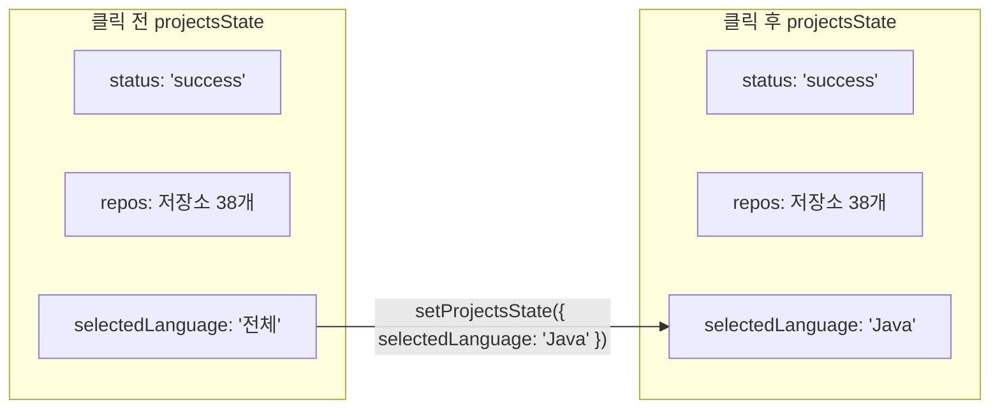

### 3-3. 배열 (저장소 목록)

- 정의 : 순서가 있는 값의 목록
- 요약 : API 응답 = 저장소 객체의 배열
- 과제 요구 : `map`으로 GitHub 데이터를 카드로 변환, `filter`로 조건에 맞는 프로젝트만 표시
- 구현 : `js/projects.js`의 `fetchRepos()`, `renderProjects()`
- 세부 설명
  - API 원본 객체에는 값이 80개 넘게 들어 있다 → `toProject()`로 화면에 쓰는 6개만 남긴 새 객체 배열로 바꾼다

    | 원본 (GitHub API) | 화면용 (`toProject`) |
    | --- | --- |
    | `html_url` | `url` |
    | `stargazers_count` | `stars` |
    | `language: null` | `language: '기타'` |
    | `description: null` | `description: '설명이 없습니다.'` |
    | `updated_at: '2026-10-10T20:25:04Z'` | `updatedAt: '2026. 10. 11.'` |

  - 원본 배열은 바꾸지 않고 `filter` / `map`이 **새 배열**을 만든다

**예시 상황** : 내 계정 저장소 43개 중 포크 5개를 빼면 38개, 그중 Java 필터를 누르면 17개가 카드로 그려진다

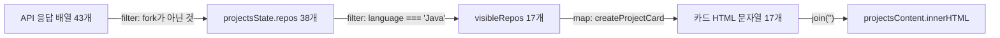

### 3-4. Set (언어 목록)

- 정의 : **중복을 허용하지 않는** 값의 모음
- 요약 : 넣기만 하면 중복이 자동으로 빠진다
- 과제 요구 : [보너스] 언어별 필터 버튼 생성
- 구현 : `js/projects.js`의 `createFilterButtons()`
- 세부 설명
  - 저장소 38개의 언어를 모으면 `Java`가 17번 나온다 → `Set`에 넣으면 1번만 남는다
  - 스프레드(`...`)로 다시 배열로 바꾼 뒤 맨 앞에 `'전체'`를 붙인다

    ```js
    const languages = [ALL_LANGUAGES, ...new Set(repos.map(({ language }) => language))];
    // ['전체', 'Python', '기타', 'Shell', 'Java', 'HTML', 'Kotlin']
    ```

**예시 상황** : Java 필터 버튼이 하나만 생기도록, 38개 저장소의 언어에서 중복을 지운다

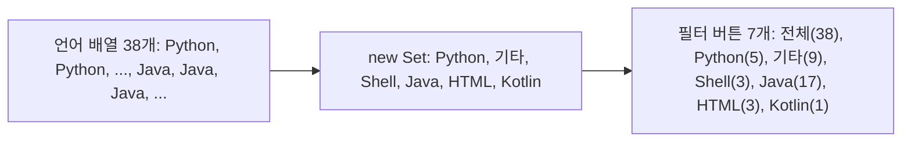

### 3-5. 필드 이름 → 값 매핑 객체

- 정의 : 키(필드 이름)로 값(검사 함수, 에러 문구)을 바로 찾는 객체
- 요약 : `if-else` 대신 "이름표로 서랍 열기"
- 과제 요구 : 필수값 검증, 이메일 형식 검증, 에러 메시지를 입력 필드 근처에 표시
- 구현 : `js/form.js`의 `validators`, `formErrors`
- 세부 설명
  - `validators` : 필드 이름 → 검사 함수 (통과하면 `''`, 실패하면 에러 문구 반환)
  - `formErrors` : 필드 이름 → 현재 에러 문구 (폼의 유효성 **상태**)
  - `<input name="email">`의 `name`이 곧 키라서, 어떤 필드에서 이벤트가 와도 `validators[field.name]` 한 줄로 처리한다

**예시 상황** : 방문자가 이메일 칸에 `test@`를 입력하면 `validators.email`이 실행되고 `formErrors.email`에 에러 문구가 저장된다

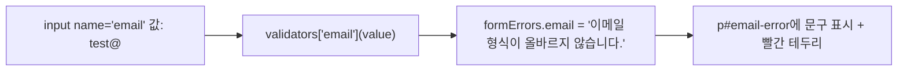

### 3-6. 로컬스토리지 (키-값 저장소)

- 정의 : 브라우저가 사이트 주소별로 **문자열 키-값**을 저장해 두는 공간 (탭을 닫거나 새로고침해도 남음)
- 요약 : 브라우저 안의 작은 사전
- 과제 요구 : 다크 모드 설정을 저장해 새로고침 후에도 유지
- 구현 : `js/theme.js`의 `readSavedTheme()`, `saveTheme()`
- 세부 설명
  - 저장하는 값은 1개 : 키 `theme`, 값 `'light'` 또는 `'dark'`
  - 확인 방법 : 크롬 개발자 도구 → Application → Local Storage → 사이트 주소
  - 서버가 아니라 **그 브라우저에만** 저장된다 (다른 기기와 공유되지 않음)

**예시 상황** : 방문자가 다크 모드를 켜고 새로고침하면, 저장된 `theme: 'dark'`를 읽어 다시 다크 모드로 시작한다

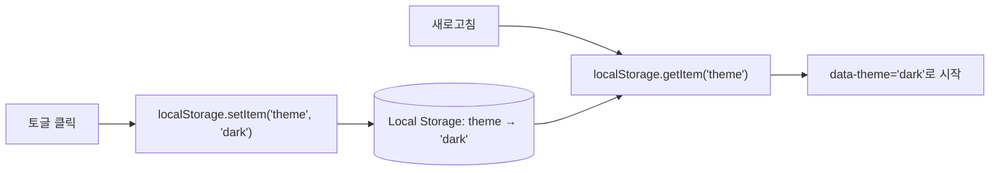

---

## 4. 사용한 알고리즘

### 4-1. 상태 → 렌더링 갱신

- 정의 : 이벤트 처리 함수는 상태만 바꾸고, 렌더 함수가 상태를 읽어 화면 전체를 다시 그리는 절차
- 요약 : 바꾸기와 그리기를 분리
- 과제 요구 : "사용자 이벤트 → 상태 변경 → 화면 업데이트" 흐름
- 구현 : `js/projects.js`의 `setProjectsState()` → `renderProjects()`
- 세부 설명
  - 1단계 : 이벤트 발생 (필터 버튼 클릭)
  - 2단계 : `setProjectsState({ selectedLanguage: 'Java' })`
  - 3단계 : `renderProjects()`가 상태를 구조분해로 꺼내 필터 버튼과 카드 영역을 `innerHTML`로 새로 그림
  - 같은 상태면 언제 그려도 같은 화면이 나온다

**예시 상황** : 방문자가 Java 필터를 누르면 상태 변경 한 번으로 버튼 강조와 카드 목록이 함께 바뀐다

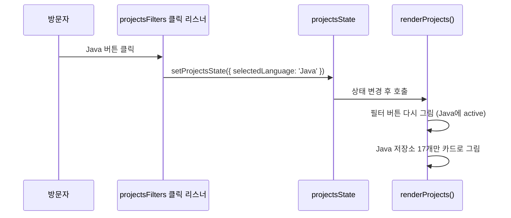

### 4-2. 요청 상태 전이

- 정의 : API 요청의 진행 단계를 `loading` · `success` · `empty` · `error` 네 상태로 나누고, 상태마다 다른 화면을 보여 주는 절차
- 요약 : 요청 결과에 따라 상태 하나를 고르고 그 상태의 화면을 그린다
- 과제 요구 : 로딩(스피너 / "로딩 중..."), 성공(카드), 에러("프로젝트를 불러올 수 없습니다" + 재시도 버튼), 빈 상태("표시할 프로젝트가 없습니다")
- 구현 : `js/projects.js`의 `fetchRepos()`, `renderProjects()`
- 세부 설명

  | 상태 | 언제 | 화면 |
  | --- | --- | --- |
  | `loading` | `fetchRepos()` 시작 직후 | 스피너 + "로딩 중..." |
  | `success` | 응답 OK, 포크 제외 저장소 1개 이상 | 언어 필터 + 카드 그리드 |
  | `empty` | 응답 OK, 저장소 0개 | "표시할 프로젝트가 없습니다." |
  | `error` | 응답 실패(403 · 404 등) 또는 네트워크 실패 | "프로젝트를 불러올 수 없습니다." + 원인 + 다시 시도 |

  - 다시 시도 버튼은 `fetchRepos()`를 다시 호출 → `loading`부터 다시 시작

**예시 상황** : 방문자가 Projects로 이동했을 때 요청이 진행 중이면 스피너가 보이고, 끝나면 카드가 보인다 (요청 한도 초과면 에러 → 다시 시도)

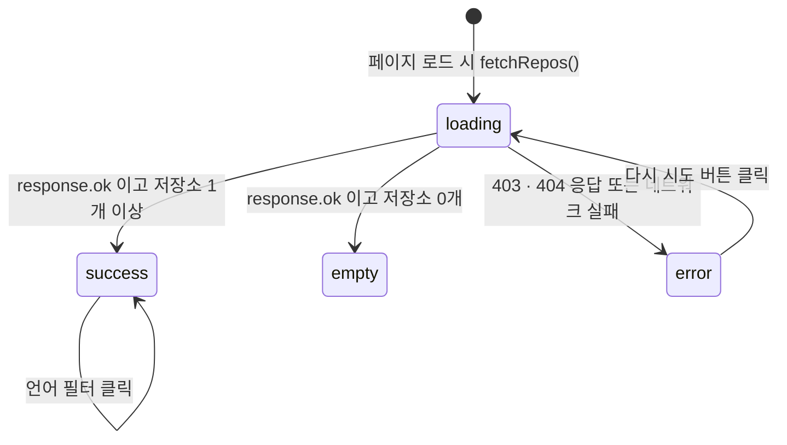

### 4-3. 배열 파이프라인 (filter → map → join)

- 정의 : 배열을 여러 메서드에 차례로 통과시켜 원하는 결과로 바꾸는 절차
- 요약 : 거르고 → 바꾸고 → 합친다
- 과제 요구 : `map`(GitHub 데이터를 HTML 카드로), `filter`(특정 조건만 표시)
- 구현 : `js/projects.js`의 `fetchRepos()`(포크 제외), `renderProjects()`(언어 필터 + 카드 변환)
- 세부 설명
  - `filter(({ fork }) => !fork)` : 내가 만든 저장소만 남김
  - `filter(({ language }) => language === selectedLanguage)` : 선택한 언어만 남김 (`'전체'`면 건너뜀)
  - `map(createProjectCard)` : 저장소 객체 → 카드 HTML 문자열
  - `join('')` : 문자열 배열을 하나로 합쳐 `innerHTML`에 한 번에 넣음 (DOM을 17번이 아니라 1번만 바꿈)

**예시 상황** : Java 필터를 누른 순간 38개 저장소가 17개 카드 HTML 한 덩어리로 바뀐다

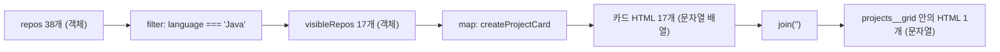

### 4-4. 폼 유효성 검사

- 정의 : 입력값이 규칙(필수, 형식, 길이)을 지키는지 순서대로 확인하고, 처음 어긴 규칙의 에러 문구를 돌려주는 절차
- 요약 : 빈칸 확인 → 형식 확인 → 통과
- 과제 요구 : 필수값 검증, 이메일 형식 검증, 에러 메시지를 필드 근처에 표시, 제출 시 `preventDefault` 후 성공 메시지
- 구현 : `js/form.js`의 `validators`, `validateField()`, `submit` 리스너
- 세부 설명
  - 규칙

    | 필드 | 규칙 | 에러 문구 |
    | --- | --- | --- |
    | 이름 | 공백 제외 1자 이상 | 이름을 입력해 주세요. |
    | 이메일 | 비어 있지 않음 → `EMAIL_PATTERN` 통과 | 이메일을 입력해 주세요. / 이메일 형식이 올바르지 않습니다. |
    | 메시지 | 비어 있지 않음 → 10자 이상 | 메시지를 입력해 주세요. / 메시지는 10자 이상 입력해 주세요. |

  - 이메일 정규식 `/^[^\s@]+@[^\s@]+\.[^\s@]+$/` : "공백과 @가 아닌 글자들 + @ + 글자들 + . + 글자들"
    - `test@` ✗ (@ 뒤가 비어 있음), `test@example` ✗ (점 없음), `test@example.com` ✓
  - 검사 시점
    - `input` : 글자를 칠 때마다 그 필드만 검사 → 고치는 즉시 에러가 사라짐
    - `submit` : `preventDefault()`로 새로고침을 막고 세 필드를 모두 검사 → 실패하면 첫 번째 틀린 칸에 포커스
  - `<form novalidate>` : 브라우저 기본 말풍선 대신 내가 만든 에러 문구를 보여 주기 위해 사용

**예시 상황** : 방문자가 이메일을 `test@`로 입력하면 형식 에러가 뜨고, `test@example.com`으로 고치면 에러가 사라진다

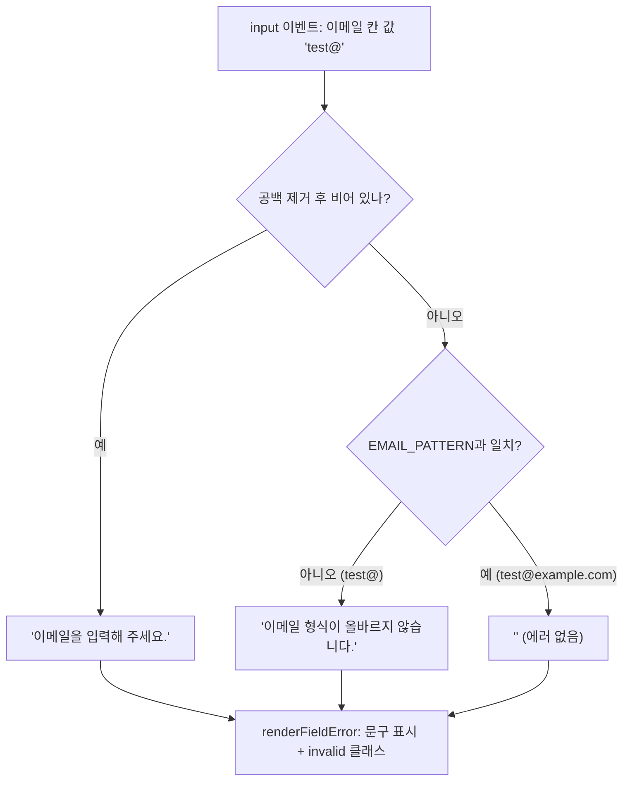

### 4-5. 테마 결정 순서

- 정의 : 처음 열 때 어떤 테마로 시작할지 정하는 우선순위 규칙
- 요약 : 저장값 → 시스템 설정 → 라이트
- 과제 요구 : 다크 모드 설정 로컬스토리지 저장 · 유지, [보너스] `prefers-color-scheme`으로 시스템 설정 감지
- 구현 : `js/theme.js`의 `getInitialTheme()`, `systemDarkQuery`의 `change` 리스너
- 세부 설명
  - 1순위 : 로컬스토리지의 `theme` (사용자가 직접 고른 값)
  - 2순위 : `window.matchMedia('(prefers-color-scheme: dark)')` (운영체제 다크 모드 여부)
  - 사용자가 한 번도 고르지 않았다면, 운영체제 설정을 바꿀 때 사이트도 바로 따라 바뀐다

**예시 상황** : 운영체제가 다크 모드인 휴대폰으로 처음 들어오면 다크로 시작하고, 직접 라이트로 바꾼 뒤에는 저장값(라이트)이 우선한다

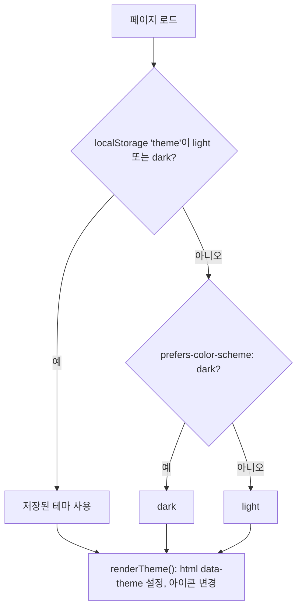

### 4-6. 스크롤 위치 판정

- 정의 : 현재 스크롤 위치(`scrollY`)를 기준값과 비교해 요소의 클래스를 붙이거나 떼는 절차
- 요약 : 기준값 이상이면 `add`, 미만이면 `remove`
- 과제 요구 : 스크롤 300px 이상에서 맨 위로 버튼, 60px 이상에서 네비게이션 배경 변경, 기준값 README에 명시
- 구현 : `js/nav.js`의 `handleScroll()`
- 세부 설명
  - **사용한 기준값**

    | 상수 | 값 | 결과 |
    | --- | --- | --- |
    | `NAV_SCROLL_THRESHOLD` | `60`px | 헤더에 `.scrolled` → 배경색 + 그림자 |
    | `SCROLL_TOP_THRESHOLD` | `300`px | 버튼에 `.visible` → 맨 위로 버튼 등장 |

  - 페이지를 열 때도 `handleScroll()`을 한 번 호출 → 새로고침으로 중간 위치에서 시작해도 상태가 맞음
  - `{ passive: true }` : 스크롤을 막지 않겠다고 브라우저에 알려 스크롤이 버벅이지 않게 함

**예시 상황** : 방문자가 100px 내리면 헤더 배경만 생기고, 400px 내리면 맨 위로 버튼도 나타난다

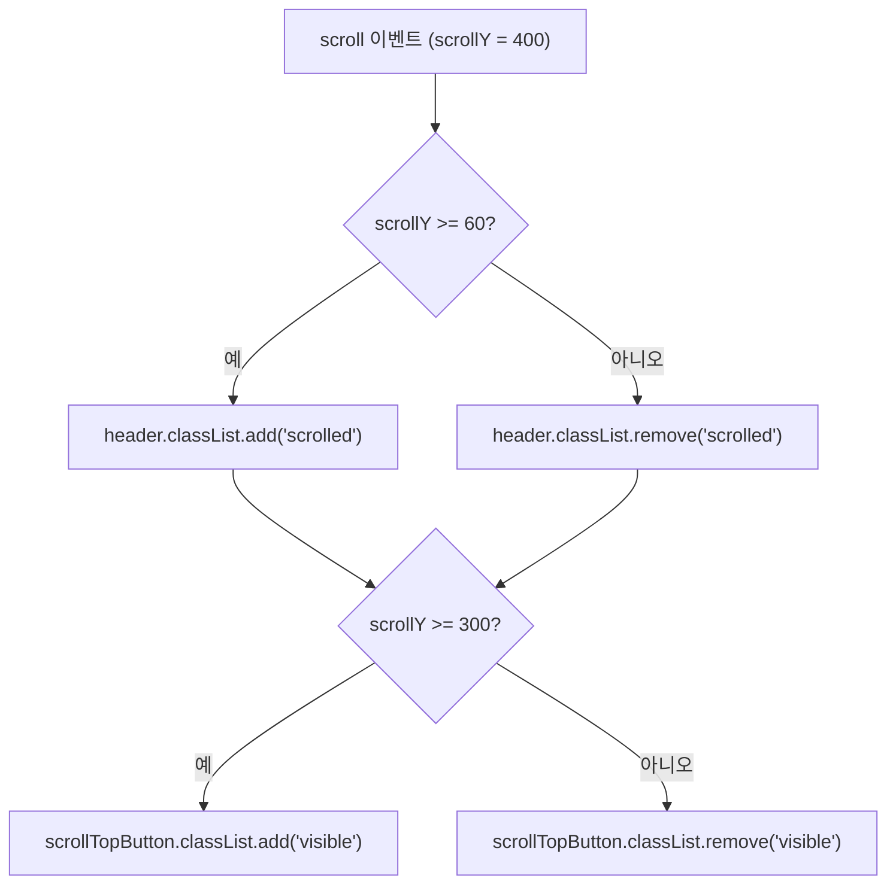

### 4-7. 등장 애니메이션

- 정의 : `.reveal` 요소가 화면에 20% 이상 들어오면 `.is-visible`을 붙여 CSS 전환(투명 → 불투명, 아래 → 제자리)을 일으키는 절차
- 요약 : 보이면 클래스 붙이고, 관찰 끝
- 과제 요구 : Intersection Observer 스크롤 애니메이션, threshold 0.2 이상
- 구현 : `js/animation.js`의 `revealObserver`, `css/style.css`의 `.reveal`, `.reveal.is-visible`
- 세부 설명
  - JS는 클래스만 붙이고, 움직임은 CSS `transition`(0.6초)이 담당
  - 한 번 나타난 요소는 `unobserve` → 다시 올라가도 깜빡이지 않고 감시 비용도 줄어듦
  - 프로젝트 카드 그리드 전체에는 걸지 않았다 → 모바일에서 카드 38개 높이는 화면의 몇 배라 "20% 보임"에 도달하지 못할 수 있기 때문 (제목 영역에만 적용)

**예시 상황** : 방문자가 문의 폼까지 스크롤해 폼이 20% 보이는 순간 폼이 아래에서 떠오른다

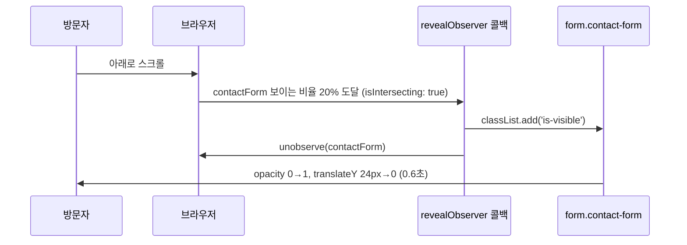

### 4-8. 이벤트 위임

- 정의 : 자식 요소마다 리스너를 거는 대신 **부모 하나에 리스너를 걸고**, 버블링으로 올라온 이벤트의 `event.target`으로 어떤 자식이 눌렸는지 판단하는 방식
- 요약 : 버튼이 몇 개든, 다시 그려지든 리스너는 1개
- 과제 요구 : 재시도 버튼, [보너스] 필터 버튼 (둘 다 `innerHTML`로 매번 새로 만들어지는 버튼)
- 구현 : `js/projects.js`의 `projectsFilters`, `projectsContent` 클릭 리스너
- 세부 설명
  - 문제 : `innerHTML`로 다시 그리면 예전 버튼이 사라지면서 거기에 걸어 둔 리스너도 같이 사라진다
  - 해결 : 다시 그려지지 않는 부모(`.projects__filters`)에 한 번만 등록
  - 비교 : 필터 버튼이 N개일 때

    | 방식 | 등록 횟수 | 필터를 누를 때마다 |
    | --- | --- | --- |
    | 자식(버튼)마다 등록 | N번 (`forEach`) | 다시 그려진 새 버튼 N개에 **또 등록**해야 함 (빠뜨리면 클릭이 안 됨) |
    | 부모에 한 번 등록 (위임) | 1번 | 부모는 그대로 남아 있으므로 할 일 없음 |

  - `event.target.closest('.filter-btn')` : 버튼 안의 글자를 눌러도 가장 가까운 버튼을 찾아 줌
  - `button.dataset.language` : 버튼의 `data-language="Java"` 값을 읽음

**예시 상황** : 방문자가 Java 버튼을 누르면 클릭 이벤트가 부모 `projects__filters`까지 올라와 처리된다

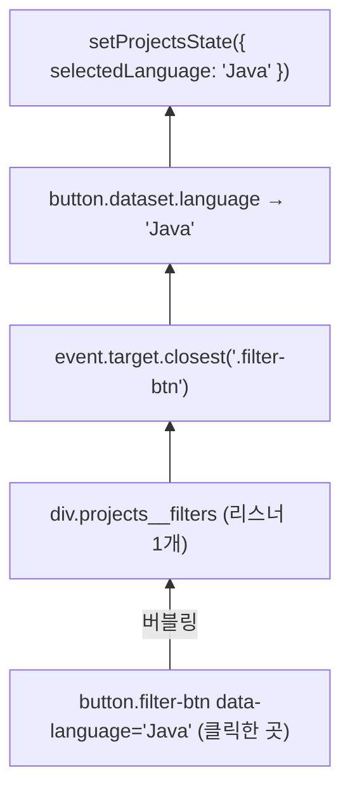

### 4-9. [보너스] 타이핑 효과

- 정의 : 문장을 비운 뒤 일정 간격으로 한 글자씩 늘려 다시 쓰는 절차
- 요약 : `setTimeout`으로 자기 자신을 다시 예약
- 과제 요구 : [보너스] Hero 섹션 타자기 효과
- 구현 : `js/animation.js`의 `typeNextChar()`
- 세부 설명
  - 원래 문장은 HTML에 그대로 적혀 있다 → JS가 꺼져 있어도 문장은 보임
  - 90ms마다 `fullText.slice(0, typedLength)`로 앞에서부터 한 글자씩 더 보여 줌
  - 다 쓰면 `.done` 클래스 → CSS 커서 깜빡임 종료

**예시 상황** : 방문자가 처음 들어오면 "백엔드 개발자를 꿈꾸는 이초롱"이 한 글자씩 써진다

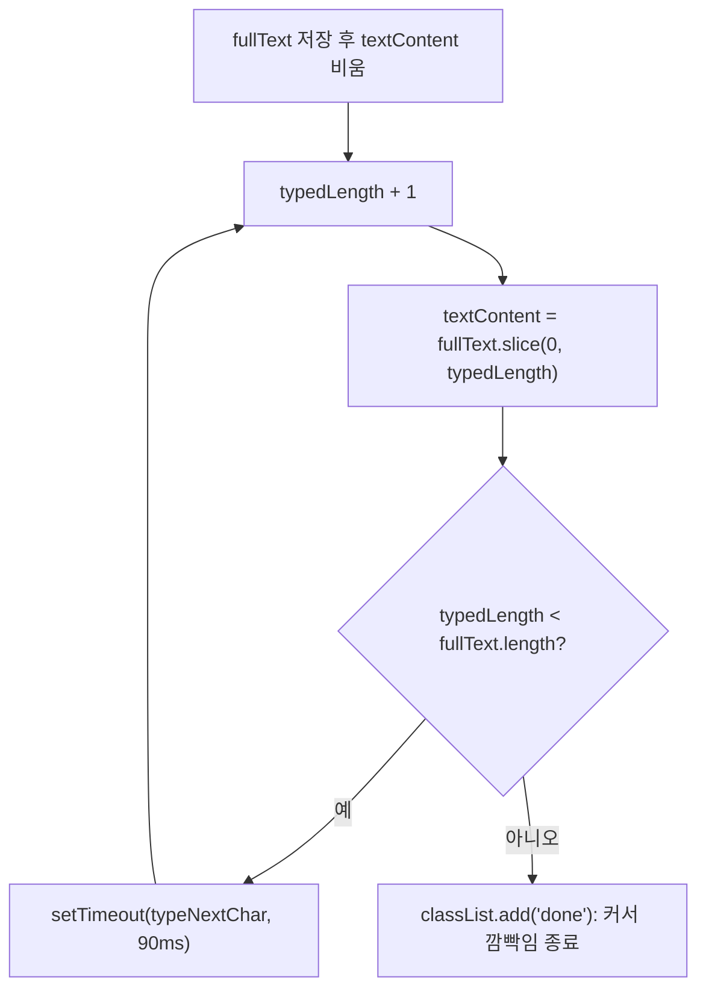

---

## 5. 실행 방법

### 배포 사이트

- https://0802222.github.io/Codyssey-B1-1-MyProfile/ 에 접속

### 로컬 실행 (VS Code + Live Server)

1. 저장소 받기

   ```bash
   git clone https://github.com/0802222/Codyssey-B1-1-MyProfile.git
   ```

2. VS Code로 폴더 열기 → 확장 프로그램 **Live Server** 설치
3. `index.html`에서 우클릭 → **Open with Live Server**
4. `http://127.0.0.1:5500/index.html`이 열리고, 파일을 저장할 때마다 자동 새로고침

- Live Server가 없다면 터미널에서 `python3 -m http.server 5500` 후 `http://localhost:5500` 접속
- `index.html`을 더블클릭(`file://`)해도 열리지만, 실제 배포 환경과 같도록 서버로 여는 것을 권장

### 상태 확인용 주소 파라미터

- `?user=아이디`를 붙이면 그 계정의 저장소를 불러온다 (기본값 `0802222`)

  | 주소 | 확인할 수 있는 상태 |
  | --- | --- |
  | `index.html` | 성공 (내 저장소 38개) |
  | `index.html?user=ghost` | 빈 상태 (저장소 0개인 계정) |
  | `index.html?user=this-user-should-not-exist-b11` | 에러 상태 (404) |

- GitHub API는 인증 없이 **시간당 60회**까지만 호출된다 → 짧은 시간에 새로고침을 반복하지 않기

---

## 6. 기능

| 기능 | 설명 | 구현 위치 |
| --- | --- | --- |
| 반응형 레이아웃 | 모바일(기본) → 768px 태블릿 → 1024px 데스크톱 | `css/style.css` |
| 햄버거 메뉴 | 모바일에서 버튼 클릭 시 메뉴 열기 / 닫기, 메뉴 링크 클릭 시 자동 닫힘 | `js/nav.js` |
| 부드러운 스크롤 | 모든 `#앵커` 링크 클릭 시 해당 섹션으로 부드럽게 이동 | `js/nav.js` |
| 헤더 배경 변경 | 스크롤 60px 이상에서 헤더 배경 + 그림자 | `js/nav.js` |
| 맨 위로 버튼 | 스크롤 300px 이상에서 등장, 클릭 시 맨 위로 | `js/nav.js` |
| 다크 모드 | 토글 클릭 시 전환, 로컬스토리지 저장 | `js/theme.js` |
| hover 효과 | 버튼은 2px, 카드는 4px 떠오르고 카드 그림자(`box-shadow`)가 진해짐, 모두 `transition: 0.25s` | `css/style.css` |
| 스크롤 애니메이션 | 요소가 20% 보이면 아래에서 떠오름 | `js/animation.js` |
| GitHub 프로젝트 | API로 저장소 카드 렌더링, 로딩 / 성공 / 빈 / 에러 상태 + 재시도 | `js/projects.js` |
| 문의 폼 검증 | 필수값, 이메일 형식, 메시지 10자 이상, 성공 메시지 | `js/form.js` |
| [보너스] 언어별 필터 | 언어 버튼으로 프로젝트 거르기, 언어별 개수 표시 | `js/projects.js` |
| [보너스] 타이핑 효과 | Hero 문장이 한 글자씩 써짐 | `js/animation.js` |
| [보너스] 시스템 다크 모드 감지 | 저장값이 없으면 운영체제 설정을 따르고, 바뀌면 즉시 반영 | `js/theme.js` |
| [보너스] 폼 실제 전송 | 구현하지 않음 (입력 검증과 성공 메시지까지만) | - |

---

## 7. 시연

### 데스크톱 (1280px)

| 첫 화면 | 전체 페이지 (Java 필터 선택 상태) |
| --- | --- |
|  | 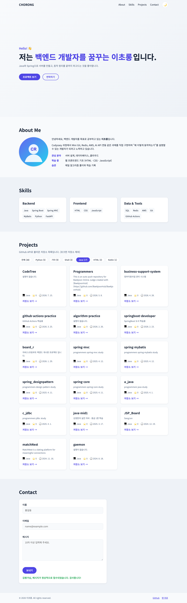 |

### 모바일 (375px)

| 첫 화면 | 햄버거 메뉴 열림 | Projects |
| --- | --- | --- |
| 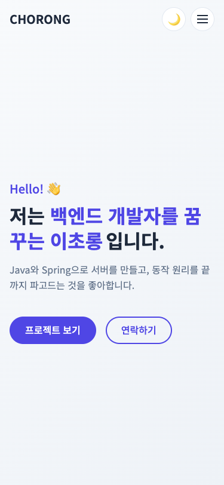 | 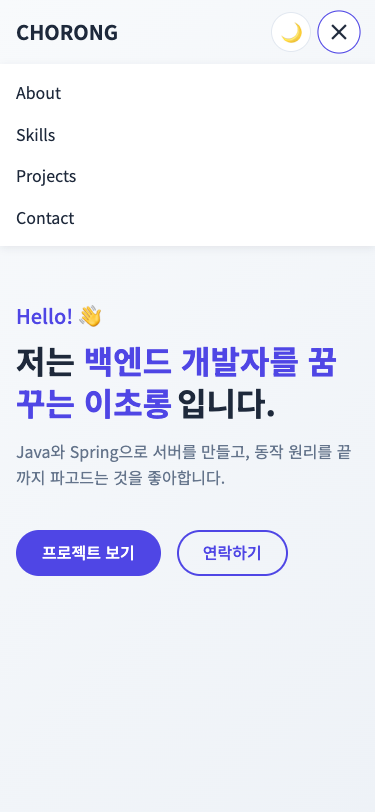 | 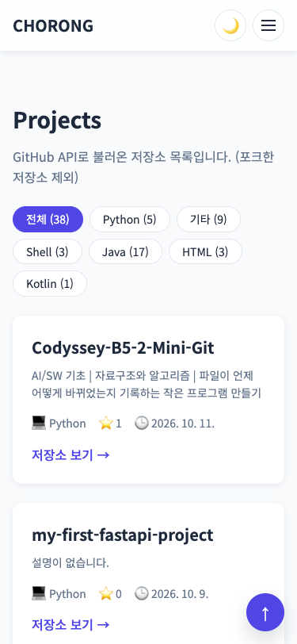 |

### 다크 모드

| 첫 화면 | Projects |
| --- | --- |
| 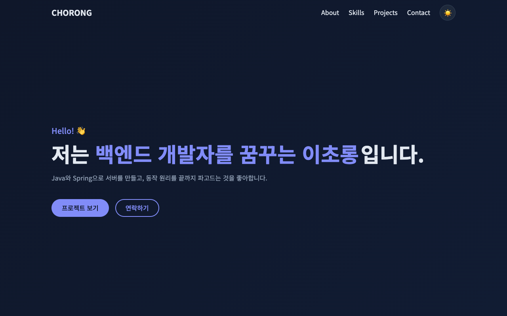 | 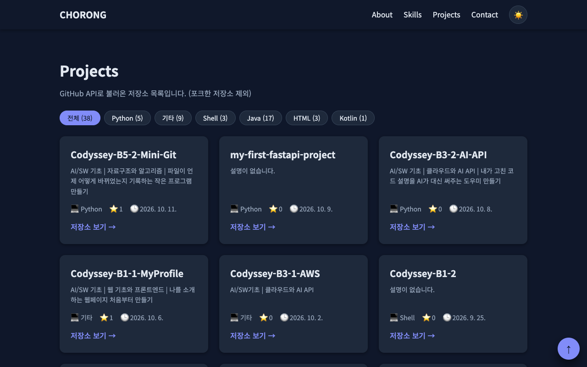 |

### Projects 상태별 화면

| 로딩 | 에러 (404) | 빈 상태 |
| --- | --- | --- |
| 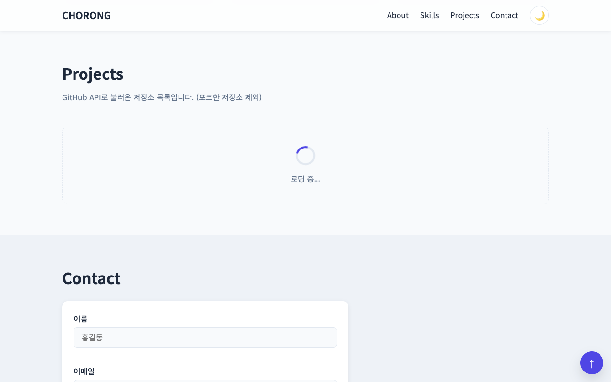 | 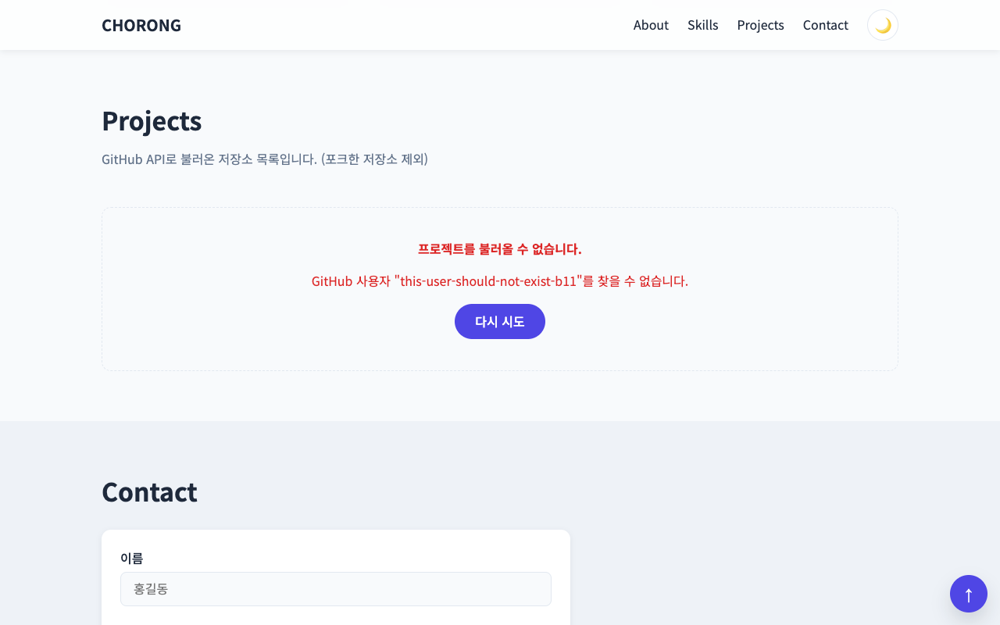 | 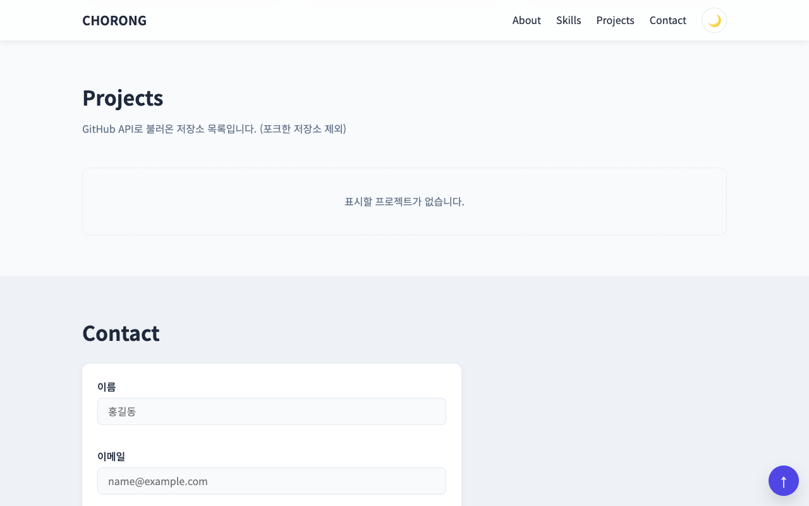 |

### 문의 폼

| 검증 실패 (메시지 10자 미만) | 제출 성공 |
| --- | --- |
| 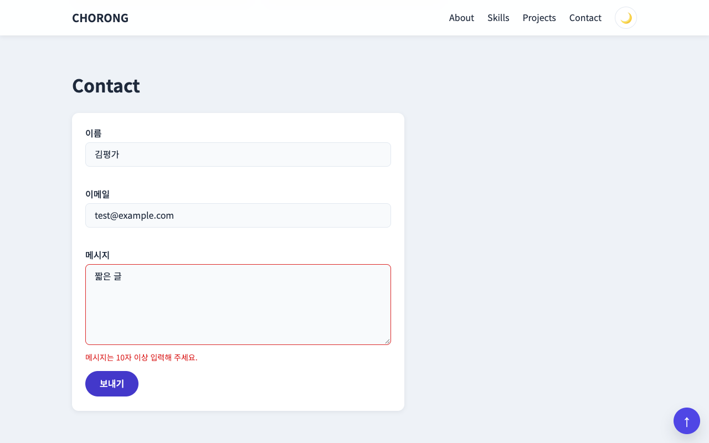 | 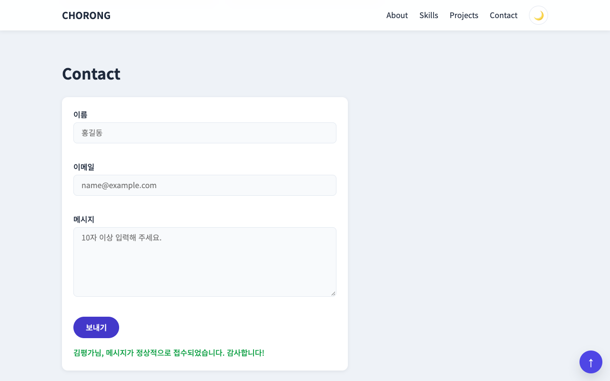 |

---

## 8. 프로젝트 구조

```text
Codyssey-B1-1-MyProfile/
├── index.html            # 메인 페이지 (시맨틱 마크업)
├── css/
│   └── style.css         # CSS 변수, 다크 모드, 모바일 퍼스트 반응형
├── js/
│   ├── theme.js          # 다크 모드 (상태: currentTheme)
│   ├── nav.js            # 햄버거 메뉴, 부드러운 스크롤, 헤더 배경, 맨 위로 버튼
│   ├── animation.js      # 스크롤 애니메이션, [보너스] 타이핑 효과
│   ├── form.js           # 문의 폼 검증 (상태: formErrors)
│   └── projects.js       # GitHub API, 상태별 렌더링, [보너스] 언어 필터 (상태: projectsState)
├── images/
│   ├── profile.svg       # 프로필 이미지
│   ├── favicon.svg       # 탭 아이콘
│   └── screenshots/      # README 시연 이미지
├── docs/
│   └── evaluation-qa.md  # 평가 대비 문답
├── scripts/
│   └── demo.mjs          # 시연 자동화 (정적 검사 + 헤드리스 Chrome 기능 테스트)
└── README.md
```

- JS를 기능별 파일로 나눈 이유 : 파일 이름만 보고 어떤 기능이 어디 있는지 찾을 수 있게
- 다섯 파일 모두 `defer` → HTML 파싱이 끝난 뒤 **적힌 순서대로** 실행되므로 `querySelector`가 항상 요소를 찾는다

---

## 9. 명령 처리 흐름

### 페이지를 열었을 때

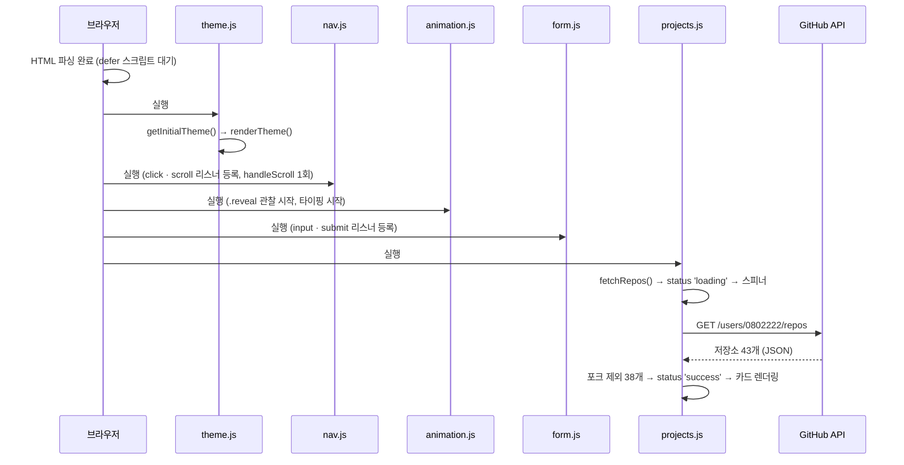

### 사용자 이벤트 → 상태 → 화면

| 사용자 행동 | 이벤트 | 상태 변경 | 화면 업데이트 |
| --- | --- | --- | --- |
| 햄버거 버튼 클릭 | `click` | `nav__menu`의 `active` 클래스 유무 | 메뉴 표시 / 숨김, 버튼 ☰ ↔ ✕ |
| 메뉴 링크 클릭 | `click` | (없음, 기본 이동 취소) | 섹션으로 부드럽게 이동, 메뉴 닫힘 |
| 스크롤 | `scroll` | `scrollY`와 기준값 비교 결과 | 헤더 배경, 맨 위로 버튼 |
| 다크 모드 토글 | `click` | `currentTheme` + 로컬스토리지 | 전체 색상, 아이콘 🌙 ↔ ☀️ |
| 페이지 로드 / 다시 시도 | (함수 호출) | `projectsState.status` | 스피너 / 카드 / 빈 / 에러 |
| [보너스] 필터 클릭 | `click` | `projectsState.selectedLanguage` | 버튼 강조, 카드 목록 |
| 폼 입력 | `input` | `formErrors[필드]` | 에러 문구, 빨간 테두리 |
| 폼 제출 | `submit` | `formErrors` 전체 | 에러 표시 또는 성공 메시지 + 입력칸 비움 |

---

## 10. 예외 처리

| 상황 | 처리 | 위치 |
| --- | --- | --- |
| API 레이트 리밋 초과 (403 · 429) | "요청 한도(시간당 60회)를 초과했습니다" + 다시 시도 버튼 | `projects.js` `getErrorMessage()` |
| 없는 GitHub 사용자 (404) | "GitHub 사용자 "아이디"를 찾을 수 없습니다" + 다시 시도 | `projects.js` `getErrorMessage()` |
| 기타 서버 오류 (500 등) | "GitHub 서버 응답 오류가 발생했습니다. (HTTP 코드)" | `projects.js` `getErrorMessage()` |
| 네트워크 끊김 | `fetch`가 `TypeError`를 던짐 → "네트워크 연결을 확인해 주세요." | `projects.js` `fetchRepos()`의 `catch` |
| 저장소 0개 | `empty` 상태 → "표시할 프로젝트가 없습니다." | `projects.js` `renderProjects()` |
| 저장소 설명 · 언어가 `null` | "설명이 없습니다." / "기타"로 대체 | `projects.js` `toProject()` |
| 저장소 설명에 `<`, `>` 같은 문자 | `escapeHTML()`로 바꿔서 태그로 해석되지 않게 함 | `projects.js` `escapeHTML()` |
| 설명 속 긴 URL | `overflow-wrap: anywhere`로 카드 밖으로 넘치지 않게 함 | `style.css` `.project-card__desc` |
| 로컬스토리지 사용 불가 (사생활 보호 모드 등) | `try/catch`로 감싸 저장만 건너뜀, 테마 전환은 그대로 동작 | `theme.js` `readSavedTheme()`, `saveTheme()` |
| 로컬스토리지에 엉뚱한 값 | `'light'` / `'dark'`가 아니면 무시하고 시스템 설정 사용 | `theme.js` `getInitialTheme()` |
| 공백만 입력 | `trim()` 후 검사 → 빈 값으로 처리 | `form.js` `validators` |
| 링크 대상 섹션이 없음 | `target`이 `null`이면 기본 동작 유지 | `nav.js` 앵커 클릭 리스너 |

- 레이트 리밋 주의 : 인증 없는 GitHub API 호출은 IP당 시간당 60회 → 한도를 넘기면 403 응답 → 위 표의 첫 줄로 처리

---

## 11. 요구사항 체크리스트

### 최종 결과물

| 요구사항 | 결과 | README 위치 |
| --- | --- | --- |
| 모든 환경에서 최적화된 반응형 레이아웃 | ✅ | [2-4. 반응형 디자인](#2-4-반응형-디자인), [7. 시연](#7-시연) |
| Hero, About, Skills, Projects, Contact, Footer 섹션 | ✅ | [2-2. 시맨틱 태그](#2-2-시맨틱-태그) |
| 다크 모드, 햄버거 메뉴, 부드러운 스크롤, 스크롤 애니메이션 | ✅ | [6. 기능](#6-기능) |
| 폼 유효성 검사 | ✅ | [4-4. 폼 유효성 검사](#4-4-폼-유효성-검사) |
| GitHub API 저장소 목록 동적 렌더링 | ✅ | [2-8. 비동기 처리](#2-8-비동기-처리) |
| 로딩 / 에러 / 빈 상태 UI | ✅ | [4-2. 요청 상태 전이](#4-2-요청-상태-전이) |
| 다크 모드 설정 로컬스토리지 유지 | ✅ | [3-6. 로컬스토리지](#3-6-로컬스토리지-키-값-저장소) |
| GitHub Pages 배포 | ✅ | [5. 실행 방법](#5-실행-방법) |

### 기능 요구 사항

| 번호 | 요구사항 | 결과 | README 위치 |
| --- | --- | --- | --- |
| 1 | 폴더 분리 (`index.html`, `css/`, `js/`, `images/`) | ✅ | [8. 프로젝트 구조](#8-프로젝트-구조) |
| 1 | 외부 스타일시트 · JS 연결 | ✅ | [2-1. 웹 페이지를 이루는 세 언어](#2-1-웹-페이지를-이루는-세-언어) |
| 1 | VS Code + Live Server 개발 환경 | ✅ | [5. 실행 방법](#5-실행-방법) |
| 2 | 시맨틱 태그 (`header`, `nav`, `main`, `section`, `article`, `footer`) | ✅ | [2-2. 시맨틱 태그](#2-2-시맨틱-태그) |
| 2 | 네비게이션 앵커 링크 | ✅ | [3-1. DOM 트리](#3-1-dom-트리) |
| 2 | 모든 이미지에 의미 있는 `alt` | ✅ | [2-2. 시맨틱 태그](#2-2-시맨틱-태그) |
| 2 | `<label for>` ↔ `id` 연결 | ✅ | [2-2. 시맨틱 태그](#2-2-시맨틱-태그) |
| 3 | 외부 스타일시트 `css/style.css` | ✅ | [8. 프로젝트 구조](#8-프로젝트-구조) |
| 3 | `:root` CSS 변수 (색상, 폰트, 간격) | ✅ | [2-5. CSS 변수와 다크 모드](#2-5-css-변수와-다크-모드) |
| 3 | `[data-theme="dark"]` 다크 모드 변수 | ✅ | [2-5. CSS 변수와 다크 모드](#2-5-css-변수와-다크-모드) |
| 3 | 네비게이션 Flexbox (로고 왼쪽, 메뉴 오른쪽) | ✅ | [2-3. Flexbox와 Grid](#2-3-flexbox와-grid) |
| 3 | Projects 카드 Grid (`auto-fit`, `minmax`) | ✅ | [2-3. Flexbox와 Grid](#2-3-flexbox와-grid) |
| 3 | 모바일 퍼스트, 768px · 1024px | ✅ | [2-4. 반응형 디자인](#2-4-반응형-디자인) |
| 3 | 모바일에서 메뉴 숨김 + 햄버거 버튼 | ✅ | [2-4. 반응형 디자인](#2-4-반응형-디자인) |
| 3 | 버튼 · 카드 hover + transition, 카드 box-shadow | ✅ | [6. 기능](#6-기능) |
| 4 | `defer`로 JS 연결 | ✅ | [2-1. 웹 페이지를 이루는 세 언어](#2-1-웹-페이지를-이루는-세-언어) |
| 4 | `var` 대신 `const` · `let` | ✅ | [2-7. ES6+ 문법](#2-7-es6-문법) |
| 4 | `onclick` 대신 `addEventListener` | ✅ | [2-6. DOM과 이벤트](#2-6-dom과-이벤트) |
| 4 | `querySelector` · `querySelectorAll`, `textContent` · `innerHTML`, `classList.add` · `remove` · `toggle` | ✅ | [2-6. DOM과 이벤트](#2-6-dom과-이벤트) |
| 4 | `click` · `submit` · `scroll` · `input` 이벤트, `preventDefault()` | ✅ | [2-6. DOM과 이벤트](#2-6-dom과-이벤트) |
| 5-a | 햄버거 메뉴 토글 (`classList.toggle('active')`) | ✅ | [3-1. DOM 트리](#3-1-dom-트리) |
| 5-b | 부드러운 스크롤 | ✅ | [6. 기능](#6-기능) |
| 5-c | 스크롤 탑 버튼 (기준 **300px**) | ✅ | [4-6. 스크롤 위치 판정](#4-6-스크롤-위치-판정) |
| 5-d | 네비게이션 스타일 변경 (기준 **60px**) | ✅ | [4-6. 스크롤 위치 판정](#4-6-스크롤-위치-판정) |
| 5-e | 다크 모드 토글 + 로컬스토리지 유지 | ✅ | [4-5. 테마 결정 순서](#4-5-테마-결정-순서) |
| 5-f | 스크롤 애니메이션 (threshold **0.2**) | ✅ | [2-9. Intersection Observer](#2-9-intersection-observer) |
| 6 | 문의 폼 (이름, 이메일, 메시지) | ✅ | [4-4. 폼 유효성 검사](#4-4-폼-유효성-검사) |
| 6 | 필수값 검증, 이메일 형식 검증 | ✅ | [4-4. 폼 유효성 검사](#4-4-폼-유효성-검사) |
| 6 | 에러 메시지를 필드 근처에 표시 | ✅ | [3-5. 필드 이름 → 값 매핑 객체](#3-5-필드-이름--값-매핑-객체) |
| 6 | 제출 시 `preventDefault()` + 성공 메시지 | ✅ | [4-4. 폼 유효성 검사](#4-4-폼-유효성-검사) |
| 7 | 화살표 함수, 템플릿 리터럴, 구조분해 할당 | ✅ | [2-7. ES6+ 문법](#2-7-es6-문법) |
| 7 | `map` · `filter` · `forEach` | ✅ | [4-3. 배열 파이프라인](#4-3-배열-파이프라인-filter--map--join) |
| 8 | `fetch` + `async/await`로 GitHub API 호출 | ✅ | [2-8. 비동기 처리](#2-8-비동기-처리) |
| 8 | 로딩 · 성공 · 에러(재시도 버튼) · 빈 상태 UI | ✅ | [4-2. 요청 상태 전이](#4-2-요청-상태-전이) |
| 8 | `try/catch` 에러 처리 | ✅ | [10. 예외 처리](#10-예외-처리) |
| 9 | "상태 → 렌더링" 흐름 3개 이상 (4개 구현) | ✅ | [2-10. 상태 → 렌더링 패턴](#2-10-상태--렌더링-패턴) |
| 10 | GitHub Pages 배포, README (설명 · 기술 · URL · 스크린샷) | ✅ | [5. 실행 방법](#5-실행-방법), [7. 시연](#7-시연) |

### 제약 사항

| 요구사항 | 결과 | README 위치 |
| --- | --- | --- |
| React, jQuery, Bootstrap 등 외부 라이브러리 미사용 (Google Fonts만 사용) | ✅ | [2-1. 웹 페이지를 이루는 세 언어](#2-1-웹-페이지를-이루는-세-언어) |
| 인라인 스타일(`style="..."`) 미사용 | ✅ | [12. 테스트](#12-테스트) |
| 최신 Chrome에서 정상 동작 | ✅ | [12. 테스트](#12-테스트) |
| 레이트 리밋(403) 시 에러 상태 UI | ✅ | [10. 예외 처리](#10-예외-처리) |

### [보너스]

| 요구사항 | 결과 | README 위치 |
| --- | --- | --- |
| [보너스] 언어별 프로젝트 필터링 (`array.filter()`) | ✅ | [3-4. Set](#3-4-set-언어-목록), [4-8. 이벤트 위임](#4-8-이벤트-위임) |
| [보너스] 타이핑 효과 | ✅ | [4-9. 타이핑 효과](#4-9-보너스-타이핑-효과) |
| [보너스] 폼 실제 전송 (Formspree / EmailJS) | ❌ 미구현 | [6. 기능](#6-기능) |
| [보너스] 시스템 다크 모드 감지 (`prefers-color-scheme`) | ✅ | [4-5. 테마 결정 순서](#4-5-테마-결정-순서) |

---

## 12. 테스트

- 환경 : macOS, Chrome 최신 버전, 로컬 서버(`python3 -m http.server`)
- 화면 크기 : 개발자 도구 기기 모드로 375px(모바일), 800px(태블릿), 1280px(데스크톱)

### 코드 규칙 검사

```bash
$ grep -rn "var " js/        # var 사용
$ grep -n "onclick" index.html js/*.js
$ grep -n 'style="' index.html js/*.js
```

- 세 명령 모두 출력 없음 (0건)

### 기능 테스트 결과

| 번호 | 테스트 | 방법 | 결과 |
| --- | --- | --- | --- |
| 1 | 콘솔 에러 | 페이지 로드 후 Console 확인 | ✅ 에러 0건 |
| 2 | 성공 상태 | 기본 주소로 접속 | ✅ 카드 38개, 필터 `전체 (38), Python (5), 기타 (9), Shell (3), Java (17), HTML (3), Kotlin (1)` |
| 3 | 로딩 상태 | Network → Slow 3G 후 새로고침 | ✅ 스피너 + "로딩 중..." |
| 4 | 빈 상태 | `?user=ghost` | ✅ "표시할 프로젝트가 없습니다." |
| 5 | 에러 상태 (404) | `?user=this-user-should-not-exist-b11` | ✅ "프로젝트를 불러올 수 없습니다. GitHub 사용자 "this-user-should-not-exist-b11"를 찾을 수 없습니다." + 다시 시도 |
| 6 | 에러 상태 (403) | 아래 콘솔 코드 실행 후 다시 시도 | ✅ "GitHub API 요청 한도(시간당 60회)를 초과했습니다. 잠시 후 다시 시도해 주세요." |
| 7 | 네트워크 실패 | Network → Offline 후 다시 시도 | ✅ "네트워크 연결을 확인해 주세요." |
| 8 | 재시도 복구 | Online으로 되돌린 뒤 다시 시도 | ✅ 카드 38개 다시 표시 |
| 9 | [보너스] 언어 필터 | Java 클릭 | ✅ 카드 17개, 모두 Java, Java 버튼만 강조 |
| 10 | 헤더 배경 | 50px / 100px 스크롤 | ✅ 50px : 없음, 100px : `.scrolled` |
| 11 | 맨 위로 버튼 | 100px / 400px 스크롤 후 클릭 | ✅ 100px : 숨김, 400px : 보임, 클릭 후 `scrollY` 0 |
| 12 | 부드러운 스크롤 | Projects 메뉴 클릭 | ✅ 섹션 상단이 헤더(64px) 바로 아래에 위치, 주소에 `#` 안 붙음 |
| 13 | 스크롤 애니메이션 | Contact까지 스크롤 | ✅ 폼에 `.is-visible` 추가 |
| 14 | 빈 폼 제출 | 아무것도 안 쓰고 보내기 | ✅ 세 필드 모두 에러, 이름 칸에 포커스 |
| 15 | 에러 사라짐 | 이름 입력 | ✅ 이름 에러 즉시 사라짐 |
| 16 | 이메일 형식 | `test@` → `test@example.com` | ✅ "이메일 형식이 올바르지 않습니다. (예: name@example.com)" → 사라짐 |
| 17 | 메시지 길이 | "짧은 글" (4자) | ✅ "메시지는 10자 이상 입력해 주세요." |
| 18 | 폼 제출 성공 | 이름 "김평가", 올바른 값으로 제출 | ✅ "김평가님, 메시지가 정상적으로 접수되었습니다. 감사합니다!", 입력칸 비움, 페이지 이동 없음 |
| 19 | 다크 모드 저장 | 토글 클릭 → 새로고침 | ✅ `localStorage.theme = "dark"`, 새로고침 후에도 다크, 아이콘 ☀️ |
| 20 | [보너스] 시스템 다크 감지 | 저장값 삭제 → Rendering 탭에서 `prefers-color-scheme: dark` / `light` 전환 | ✅ dark로 시작, light로 바꾸면 즉시 라이트 |
| 21 | [보너스] 타이핑 효과 | 첫 화면 관찰 | ✅ "백엔드 개발자를 꿈꾸는 이초롱" 한 글자씩 표시 후 커서 사라짐 |
| 22 | 데스크톱 1280px | 레이아웃 확인 | ✅ 햄버거 숨김, Projects 3열 |
| 23 | 태블릿 800px | 레이아웃 확인 | ✅ 햄버거 숨김, Skills 2열, Projects 2열 |
| 24 | 모바일 375px | 레이아웃 확인 | ✅ 햄버거 보임, 메뉴 숨김, Projects 1열, 가로 스크롤 없음 |
| 25 | 햄버거 메뉴 | 클릭 → 다시 클릭 → 열고 메뉴 링크 클릭 | ✅ 열림(`aria-expanded="true"`) → 닫힘 → 이동 후 자동 닫힘 |

- 6번 403 재현 코드 (Console에 붙여 넣은 뒤 "다시 시도" 클릭, 새로고침하면 원래대로 돌아옴)

  ```js
  window.fetch = () => Promise.resolve(new Response('{"message":"API rate limit exceeded"}', { status: 403 }));
  ```

### 자동 시연 스크립트

위 표의 테스트를 손으로 하나씩 하지 않아도 되도록 스크립트로 만들었다.

```bash
$ node scripts/demo.mjs
```

- 준비물 : Node.js 22 이상, Chrome (외부 패키지 설치 없음)
- 하는 일
    - 정적 검사 : 폴더 구조, `defer`, `var` · `onclick` · 인라인 스타일 0건, 시맨틱 태그, `alt`, `label for`, CSS 변수 · 브레이크포인트 · Grid 등 25개 항목
    - 배포 확인 : GitHub Pages 주소 응답(200), GitHub API 남은 호출 수
    - 브라우저 테스트 : 로컬 서버와 헤드리스 Chrome을 띄워 실제로 클릭 · 입력 · 스크롤하며 위 표의 항목을 확인
    - 로딩 · 403 · 네트워크 끊김은 Chrome DevTools Protocol의 `Fetch` 기능으로 GitHub API 응답을 가로채 재현
    - 단계마다 스크린샷을 `demo-output/`에 저장 (Git 추적 제외)
- 실제 GitHub API를 9회 호출하므로 시간당 60회 한도 안에서 6번 정도 반복 실행 가능

실행 결과 (요약)

```text
■ 3. GitHub API 연동 (데스크톱 1280px)
  ✅ 성공 상태: 카드 리스트 렌더링  → 카드 38개, 필터 "전체 (38)"
  ✅ [보너스] 언어 필터 (filter)  → "Python (5)" 클릭 → 카드 5개, 모두 Python
  ✅ 로딩 상태: 스피너 + "로딩 중..."
  ✅ 에러 상태 (403 레이트 리밋)  → GitHub API 요청 한도(시간당 60회)를 초과했습니다. 잠시 후 다시 시도해 주세요.
  ✅ 에러 상태 (네트워크 끊김) + 다시 시도 버튼
  ✅ 다시 시도 → 성공 복구  → 카드 38개
  ✅ 에러 상태 (404 없는 사용자)  → ?user=this-user-should-not-exist-b11
  ✅ 빈 상태: "표시할 프로젝트가 없습니다"  → ?user=ghost

■ 4. 스크롤 인터랙션 (데스크톱 1280px)
  ✅ 헤더 배경 변경 (기준 60px)  → 50px: 없음, 100px: .scrolled
  ✅ 맨 위로 버튼 (기준 300px)  → 100px: 숨김, 400px: 보임, 클릭 후 scrollY 0
  ✅ 부드러운 스크롤 (메뉴 → Projects)  → 0 → 83(이동 중) → 1521px, 주소에 # 없음
  ✅ 스크롤 애니메이션 (threshold 0.2)  → 폼에 .is-visible 추가

■ 요약
  통과 55 / 전체 55
```
